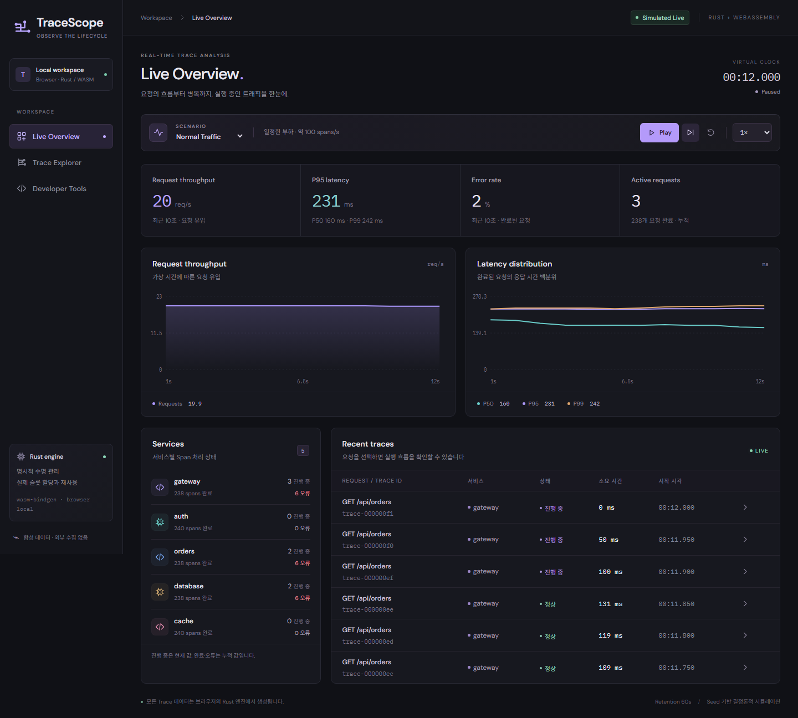
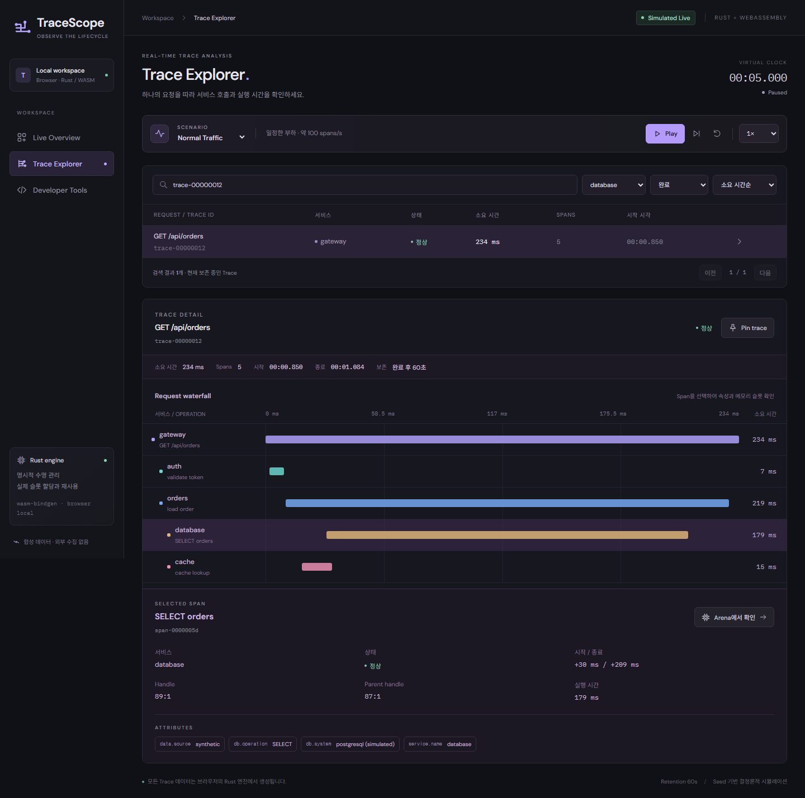
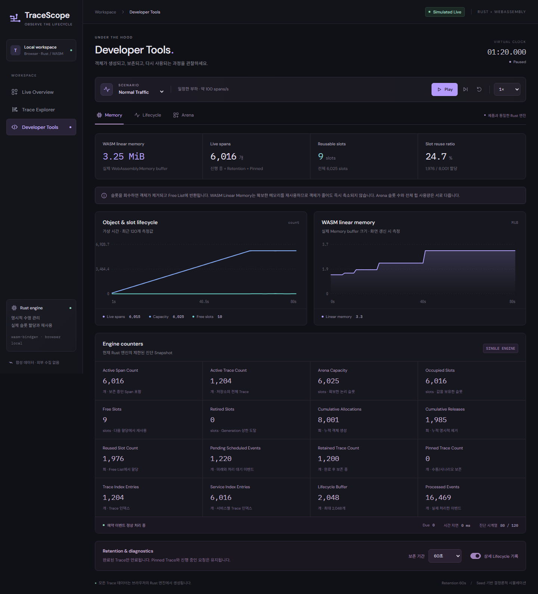
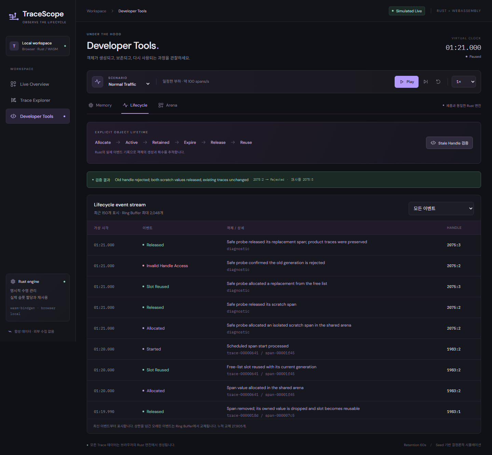
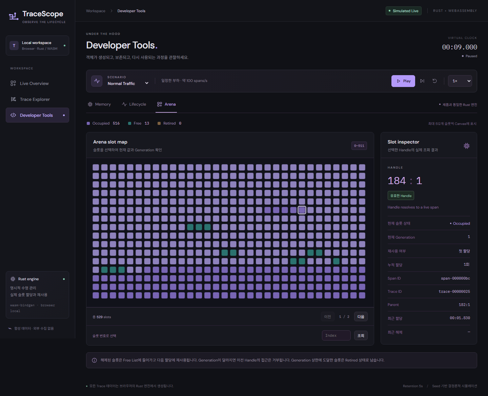
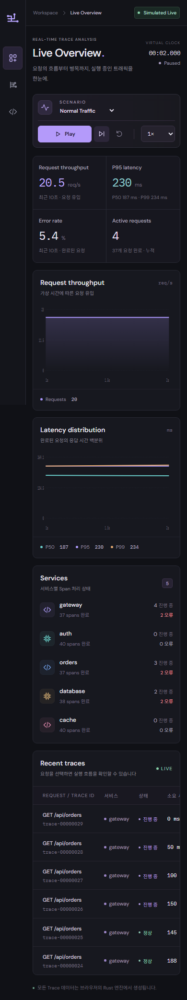
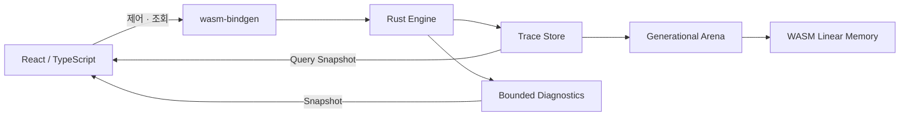
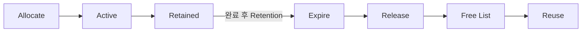

# TraceScope

**Simulated Real-Time Trace Analyzer powered by Rust and WebAssembly.**

TraceScope는 브라우저에서 합성 API 요청을 실행하고, 서비스 호출의 응답 시간·오류·병목을 분석하는 정적 웹 앱입니다. 개별 요청의 Waterfall을 확인한 뒤 같은 Span이 Rust Arena의 어떤 슬롯에 저장되고 언제 해제·재사용되는지 Developer Tools에서 따라갈 수 있습니다.

[GitHub 저장소](https://github.com/okorion/tracescope-wasm) · [배포 주소](https://okorion.github.io/tracescope-wasm/) · [구조 설명](docs/architecture.md) · [검증 기록](docs/validation.md)

모든 트래픽은 **Simulated Live**로 표시되는 합성 데이터(Synthetic Data)입니다. Rust 엔진이 시작·종료·오류·만료 이벤트를 처리하며 실제 Trace Store와 Arena를 갱신합니다. 외부 API 서버, 수집기, DB, 로그인 없이 실행됩니다.

## 제품 화면

| 화면 | 할 수 있는 일 |
| --- | --- |
| **Live Overview** | 시나리오·속도·Play/Pause·Step 제어, RPS·P50/P95/P99·오류율·진행 중 요청·서비스별 상태 확인 |
| **Trace Explorer** | Trace 검색, 서비스·상태 필터, Duration 정렬, 페이지 탐색, Waterfall·Attributes 확인, Pin/Unpin |
| **Developer Tools** | 같은 엔진의 Memory·Lifecycle·Arena 관찰, Stale Handle 검사, 선택한 Span의 슬롯 추적 |

Normal Traffic이 기본으로 실행됩니다. Overview의 최근 요청을 선택하면 Explorer로 이동합니다. Waterfall에서 Span을 선택하고 **Arena에서 확인**을 누르면 해당 Handle을 Developer Tools에서 검사할 수 있습니다. 탭을 바꿔도 엔진은 유지됩니다.

### 실행 화면

Playwright로 실행한 실제 브라우저 화면입니다.



Normal Traffic, 가상 12초. 요청 유입과 완료 결과에서 집계한 수치입니다.

<details>
<summary>Trace Explorer · 실제 Span 시각으로 그린 Waterfall</summary>



선택한 요청의 서비스 관계, 시작·종료 시각, Duration과 DB Attributes를 확인합니다. 선택 Span의 Handle로 Arena 검사 화면을 열 수 있습니다.

</details>

<details>
<summary>Developer Tools · Memory</summary>



Normal Traffic, Retention 60초, 가상 80초. Retention 이후의 객체 수와 실제 WASM 메모리 바이트를 별도 축으로 보여줍니다.

</details>

<details>
<summary>Developer Tools · Lifecycle</summary>



같은 Arena에서 안전한 Stale Handle 검사를 실행한 상태입니다. 임시 값의 생성·해제·재사용·거부 기록과 실제 Trace의 수명 이벤트가 함께 남습니다.

</details>

<details>
<summary>Developer Tools · Arena</summary>



Retention을 5초로 설정한 상태입니다. Canvas는 최대 512슬롯씩 표시하고, 선택한 슬롯의 현재 Generation·Trace·Span·부모 Handle을 조회합니다.

</details>

<details>
<summary>모바일 너비의 Live Overview</summary>



좁은 화면에서 그래프와 카드가 한 열로 배치됩니다. 요청 표는 내부 가로 스크롤로 탐색합니다. 데스크톱 Chromium의 모바일 너비 검증 화면입니다.

</details>

## 시나리오와 시간 제어

| 시나리오 | 가상 시간에 따른 동작 | 관찰할 내용 |
| --- | --- | --- |
| Normal Traffic | 20 requests/s × 5 spans, 약 100 spans/s | 60초 Retention 이후 live 객체 안정화와 슬롯 재사용 |
| Traffic Burst | 15~25초에 200 requests/s, 약 1,000 spans/s | 슬롯 확장, 회수, 정상 부하 복귀 후 기존 슬롯 활용 |
| Slow Database | 10~30초에 DB 작업 2~5초 | 활성 요청 증가와 긴 DB Span |
| Error Storm | 10~25초에 55% 오류·20% Timeout의 생성 확률 | 조기 실패, 최대 8초 Timeout, 오류 뒤 참조·인덱스 정리 |
| Pinned Traces | 초기 요청 중 세 Trace 자동 Pin | 만료 뒤 보존과 Unpin 후 회수 |

표의 비율은 시나리오 생성 설정이며 실제 화면의 오류율은 완료 이벤트에서 계산합니다. RPS와 지연 백분위수·오류율은 최근 가상 10초를 사용합니다. 초기 RPS는 실행 후 경과 시간을 분모로 사용하며 서비스별 완료·오류 수와 전체 Completed Requests는 Reset 이후 누적값입니다.

- 속도는 0.25×·1×·4×이며 가상 시간의 진행 속도만 바꿉니다. Step은 일시정지 상태에서 가상 1초를 진행합니다.
- Retention 기본값은 완료 후 가상 60초, 설정 범위는 5~120초입니다. Pin은 최대 128개입니다.
- 한 Tick은 이벤트와 만료 처리를 합쳐 최대 5,000건을 처리합니다. 남은 작업은 보존하고 대기량을 표시합니다.
- 페이지가 숨겨지면 자동 일시정지합니다. 돌아온 뒤 Play로 재개합니다.
- Reset과 시나리오 변경은 Trace·슬롯·진단 이력을 초기화하고 일시정지합니다. 브라우저 새로고침 후 데이터는 복구되지 않습니다.

## Rust/WASM 아키텍처



Rust는 가상 시계, PRNG, 이벤트 큐, Trace·Span, 검색·만료 인덱스, Pin 상태, 메트릭과 Lifecycle 기록을 소유합니다. React는 UI 선택 상태와 제한된 스냅샷을 표시합니다. 전체 Trace·Span 원본을 React State에 복제하지 않습니다.

`engine/src/scenario.rs`는 요청 도착 시 고정 Seed로 실행 계획을 만들고, `simulation.rs`는 `BinaryHeap`에서 `(가상 시각, 순번)` 순으로 이벤트를 꺼냅니다. 같은 시각에는 만료를 먼저 처리하며 자식 종료를 Root 종료보다 먼저 처리합니다. 소수점 프레임 시간은 Kahan 합산으로 누적하고 목표 시간을 1ns 단위로 정규화해, 같은 Seed·가상 시간을 여러 Tick으로 나눠도 정수 밀리초 경계의 결과가 일치하도록 구성했습니다.

`web/src/engine.ts`가 WASM 인스턴스 하나를 관리합니다. 엔진 Tick과 약 250ms 간격의 UI 스냅샷 갱신을 분리하고, Trace 목록은 기본 25개씩 조회합니다. JS↔WASM 경계는 `wasm-bindgen` 클래스와 `serde_json` 문자열입니다. 선택 이유와 검토한 대안은 [의존성 선택](docs/dependency-decisions.md), 실제 필드와 함수는 [API 계약](docs/api-contract.md)에 정리했습니다.

## Span이 생성되고 사라지는 과정



Span 시작 이벤트가 `Arena<Span>`에 실제 값을 할당합니다. Trace는 소속 Span의 Handle 목록을 갖고, Span은 부모의 Handle을 가집니다. 종료 이벤트가 시각과 상태를 갱신하며 요청 완료 후에도 Retention 동안 값을 유지합니다. 진행 중인 요청은 보존 기간만으로 제거하지 않고, 모든 요청에 최대 8초 종료 경계를 둡니다.

완료한 Trace가 만료되면 Trace 메타데이터, 서비스 검색 인덱스, 만료 인덱스와 소속 Span을 함께 제거합니다. Pin된 Trace는 이 정리에서 제외합니다. Unpin하면 완료 시각 기준의 만료 인덱스에 다시 들어가고 다음 Tick 또는 Step에서 회수됩니다.

### Generational Arena와 Handle

[`engine/src/arena.rs`](engine/src/arena.rs)의 핵심 구조는 다음과 같습니다.

```text
Handle { index: u32, generation: u32 }
Slot<T> { generation, value: Option<T>, retired, ... }
Arena<T> { slots: Vec<Slot<T>>, free_list: Vec<u32>, ... }
```

새 슬롯의 Generation은 1입니다. 제거 시 값을 꺼내 Drop하고 Generation을 올린 뒤 Index를 Free List에 넣습니다. 다음 할당은 Free List에서 Index를 꺼내 실제로 같은 슬롯을 사용합니다. Index는 같아도 Generation이 달라지므로 이전 Handle의 조회·수정·제거는 거부됩니다. Generation이 `u32::MAX`이면 해당 슬롯은 영구 Retired로 남아 다시 할당되지 않습니다.

이 구조는 Span의 위치와 수명을 관리합니다. Rust의 `Vec`, 인덱스와 직렬화 버퍼는 기본 Allocator와 Ownership/RAII가 관리합니다. Custom GC와 범용 Allocator는 구현하지 않았습니다.

### 메모리 그래프를 읽는 법

**Live Spans**는 진행 중이거나 완료 후 보존 중인 실제 Span 수입니다. **Free Slots**는 새 Span이 재사용할 수 있는 슬롯, **Arena Capacity**는 생성한 논리 슬롯 총수입니다. **WASM Linear Memory**는 WASM 모듈의 실제 `memory.buffer.byteLength`입니다.

Span을 회수해도 Arena의 저장 공간과 Linear Memory 크기는 즉시 줄지 않을 수 있습니다. Rust의 다른 할당도 같은 Linear Memory를 사용하므로 객체 수·슬롯 수·전체 메모리 바이트는 다르게 움직입니다. UI는 메모리 확장 후 현재 buffer를 다시 읽으며 이전 TypedArray view를 보관하지 않습니다. 일반 Rust 힙의 개별 live allocation 바이트는 계측하지 않습니다.

## Developer Tools 사용법

1. **Memory**에서 Live Span·Trace, Occupied/Free/Retired 슬롯, 누적 할당·회수·재사용, 대기 이벤트, 인덱스 수와 실제 WASM 바이트를 확인합니다. 객체·슬롯 수와 메모리 바이트는 별도 차트로 표시합니다.
2. **Lifecycle**에서 Rust가 기록한 Allocated → Started → Completed → Retained → Expired → Released → Slot Reused를 확인합니다. **Stale Handle 검증**은 같은 Arena의 임시 슬롯으로 오래된 Handle 거부를 검사하고 실제 Trace는 유지합니다.
3. **Arena**의 Canvas에서 슬롯을 선택하거나 Index를 입력해 현재 Generation·Trace·Span·부모 관계·최근 할당·해제 시각을 확인합니다. Explorer에서 선택했던 Span이 만료되면 무효 Handle 상태로 표시합니다.

Lifecycle은 2,048개 Ring Buffer, Rust와 JS의 시계열은 각각 최대 120개, Arena 조회는 최대 512슬롯으로 제한합니다. 상세 Lifecycle 기록을 꺼도 기본 메모리 수치는 유지됩니다. [구조 문서](docs/architecture.md)에 지표별 단위와 상한을 정리했습니다.

## 검증과 성능 측정

단순히 그래프 모양만 보지 않고 다음 조건을 검사합니다.

- Arena의 할당·수정·해제·이중 해제 방어·재사용·오래된 Handle·Generation 오버플로 정책.
- 부모·자식 시각, Trace 소속, 만료·서비스 인덱스 정리와 Pin/Unpin.
- 고정 Seed, Tick 분할, Pause·Reset·속도·다섯 시나리오의 동작.
- 장시간 정상 부하의 live 객체·슬롯 상한·재사용 증가·진단 버퍼 크기.
- 실제 컴파일한 WASM의 메모리 크기·확장 후 buffer 처리와 브라우저 사용자 흐름.

Rust 테스트 **43개**, 컴파일한 WASM 테스트 **6개**, Playwright 제품 흐름 **9개**가 통과했습니다. TypeScript 검사·프로덕션 빌드·Rust fmt·clippy도 통과했습니다. GitHub Actions에서 전체 검사를 실행한 뒤 공개된 Pages 사이트에서도 브라우저 9개를 다시 실행해 모두 통과했습니다.

2026-10-12 Windows 10 x64 · Ryzen 7 3700X · Node 25.9.0에서 release WASM을 실행한 결과입니다. Seed 42, Retention 60초, 상세 진단 켜짐, 100ms 가상 Step을 사용했습니다. Query는 25건 직렬화·JSON 파싱을 포함합니다.

| WASM 시나리오 | 가상 실행 | Tick P95 | Query P95 | 최종 재사용 | 90초 이후 논리 슬롯 / Linear Memory |
| --- | --- | --- | --- | --- | --- |
| Normal · 100 spans/s | 600초 | 0.0283ms | 0.2936ms | 53,976회 | 6,025 slots / 3,407,872 bytes |
| Burst · 15~25초 1,000 spans/s | 180초 | 0.1423ms | 0.5650ms | 11,976회 | 15,025 slots / 5,308,416 bytes |

Normal의 가상 90~600초 표본에서 Live Spans는 6,006~6,021개, 논리 슬롯과 Linear Memory는 표의 값으로 유지됐습니다. Burst는 90초에 Live Spans 6,016개·Free Slots 9,009개로 내려왔으며, 이후 기존 슬롯을 재사용했습니다. 이 값은 [원본 WASM 측정 JSON](docs/results/wasm-benchmark.json)에서 확인할 수 있습니다.

별도 Rust native release에서는 각 부하를 가상 120초 실행했습니다. 같은 Seed·Retention·상세 진단 조건이며, Query는 DB 필터·Duration 내림차순 25건을 사용합니다. [네이티브 원본 JSON](docs/results/native-benchmark.json)을 함께 제공합니다.

| Native 부하 | Tick P95 | Query P95 | 90~120초 논리 슬롯 |
| --- | --- | --- | --- |
| 100 spans/s | 0.0296ms | 0.5822ms | 6,025개로 유지 |
| 1,000 spans/s | 0.2706ms | 7.4202ms | 60,198개로 유지 |
| 10,000 spans/s | 2.8824ms | 73.3550ms | 601,660개로 유지 |

브라우저에서는 1440×1000 Headless Chromium 156의 Live Overview를 실제 시간 각 10초씩 측정했습니다. Normal과 Burst 모두 프레임 간격 P95 16.7ms, 50ms 초과 Long Task 0건이었습니다. [브라우저 원본 JSON](docs/results/browser-benchmark.json)에 표본 수·최대 간격과 조건을 남겼습니다. 10,000 spans/s의 브라우저 UI 측정은 수행하지 않았습니다.

테스트 명령·전체 수치·배포 확인은 [검증 기록](docs/validation.md)에 제공합니다. Node WASM 호출, Rust native, 실제 브라우저의 측정 대상과 Query 조건을 구분해 읽어 주세요.

## 로컬 실행

필요한 도구는 Node.js 22.12 이상과 `rustup`입니다. CI는 Node 24를 사용하며 Rust는 `rust-toolchain.toml`의 1.99.0으로 고정합니다. `npm ci`가 프로젝트용 `wasm-pack`도 설치합니다.

```sh
git clone https://github.com/okorion/tracescope-wasm.git
cd tracescope-wasm
npm ci
npm run build:wasm
npm run dev
```

개발 주소: <http://127.0.0.1:5179/tracescope-wasm/>. Rust 소스를 바꾸면 `npm run build:wasm`을 다시 실행합니다.

이번 Windows 검증 환경에는 MSVC linker가 없어 설치된 GNU Rust 도구 체인을 사용했습니다. 같은 환경에서 PowerShell 세션을 열면 먼저 다음을 설정합니다. 환경 변수는 현재 세션에만 적용됩니다.

```powershell
$env:PATH = "$env:USERPROFILE\.cargo\bin;$env:PATH"
$env:RUSTUP_TOOLCHAIN = '1.99.0-x86_64-pc-windows-gnu'
```

GNU 도구 체인에는 MinGW GCC가 PATH에 있어야 합니다. 이번 검증은 기존에 설치된 MinGW GCC를 사용했으며 저장소는 전역 설정을 변경하지 않습니다. Linux CI는 `rust-toolchain.toml`의 1.99.0 도구 체인을 사용합니다.

```sh
# Rust 검사
cargo fmt --manifest-path engine/Cargo.toml --check
cargo clippy --manifest-path engine/Cargo.toml --all-targets -- -D warnings
cargo test --manifest-path engine/Cargo.toml

# WASM + TypeScript 프로덕션 빌드
npm run build
npm run test:wasm

# 실제 Chromium 사용자 흐름
npx playwright install chromium
npm run test:e2e

# WASM 가상 시간 측정
npm run bench:wasm

# Rust native 100 / 1,000 / 10,000 spans/s 측정
cargo run --manifest-path engine/Cargo.toml --release --example benchmark

# 프로덕션 미리보기
npm run preview
```

미리보기 주소는 <http://127.0.0.1:4179/tracescope-wasm/>입니다. Linux CI에서 Playwright에 필요한 시스템 패키지는 `npx playwright install --with-deps chromium`으로 설치합니다.

## 빌드·배포

[GitHub Actions](.github/workflows/ci.yml)는 Rust fmt·clippy·test, WASM 빌드, TypeScript 검사, 컴파일한 WASM 테스트, Chromium E2E를 수행합니다. `main` 검증이 통과하면 `web/dist`를 GitHub Pages로 배포합니다. PR에서는 검사만 실행합니다.

GitHub Pages의 저장소 경로는 `/tracescope-wasm/`입니다. Vite의 `base`와 WASM asset URL을 이 경로에 맞춥니다. 다른 정적 호스팅에는 `VITE_BASE_PATH`를 지정해 빌드할 수 있습니다. 2026-10-12 공개 사이트에서 WASM의 HTTP 200·`application/wasm` 응답, 시뮬레이션과 Diagnostics 동작을 확인했습니다. [첫 CI·배포 실행](https://github.com/okorion/tracescope-wasm/actions/runs/38203317957)과 [검증 기록](docs/validation.md)에 실제 결과를 남겼습니다.

WASM은 Rust의 release 설정(`opt-level = 3`, LTO, codegen unit 1)으로 빌드합니다. 로컬 환경에서 선택적 후처리 도구인 `wasm-opt` 실행이 거부되어 해당 단계는 `engine/Cargo.toml`에서 비활성화했습니다. Rust 컴파일러 최적화는 유지되며, `wasm-opt` 적용 전후의 크기·성능 비교는 수행하지 않았습니다.

## 기술 스택과 파일 안내

Rust 1.99.0, wasm-bindgen·serde·serde_json, React 19.3, TypeScript 7, Vite 8, SVG·Canvas 2D, Playwright, GitHub Actions·Pages를 사용합니다. 정확한 버전은 `package-lock.json`과 `engine/Cargo.lock`에 고정됩니다.

```text
engine/src/       Rust 엔진, Arena, Store, 시나리오, 진단
web/src/          React UI와 단일 WASM 연결
scripts/          WASM 빌드·측정
tests/            컴파일한 WASM 테스트와 브라우저 E2E
docs/             아키텍처, API, 검증 결과, 실제 화면
.github/workflows/ci.yml
```

## 현재 범위와 한계

- 실제 서비스의 Trace 수집·OpenTelemetry 입력·백엔드·영속 저장·협업·인증은 제공하지 않습니다.
- 시나리오는 정해진 서비스 다섯 개와 요청 구조를 사용합니다. 임의 서비스 그래프 편집 기능은 없습니다.
- 엔진과 UI는 메인 스레드에서 실행합니다. Tick 이벤트 예산과 조회 상한을 두며 대기 작업은 Diagnostics에 표시합니다.
- 일반 Allocator의 개별 힙 할당량과 브라우저 전체 프로세스 메모리는 측정하지 않습니다. Linear Memory와 Arena 수치는 각각의 의미로 해석해야 합니다.
- 10,000 spans/s는 스트레스 측정용 조건입니다. 기본 UI 시나리오 부하는 100 spans/s이며 Burst 중 1,000 spans/s입니다.
- 테스트한 OS·브라우저와 장시간 측정 범위는 [검증 기록](docs/validation.md)에 명시합니다.

## 문서

- [아키텍처와 메모리 생명주기](docs/architecture.md)
- [JS↔WASM API 계약](docs/api-contract.md)
- [의존성 선택과 공식 자료](docs/dependency-decisions.md)
- [테스트·메모리 안정성·성능·배포 검증](docs/validation.md)
