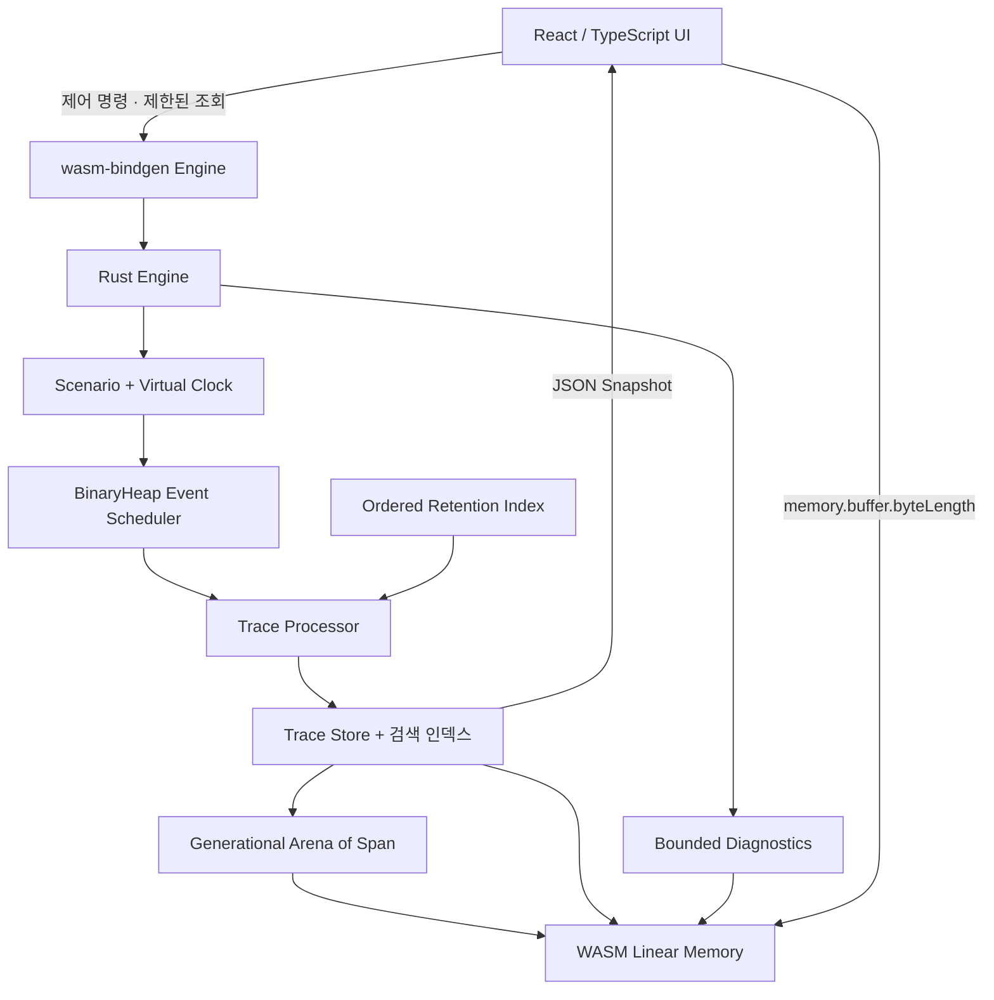
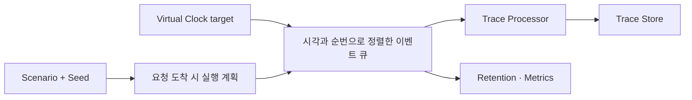
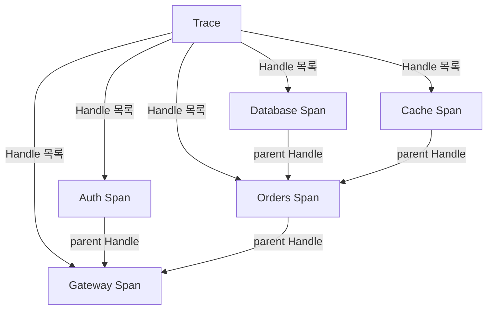
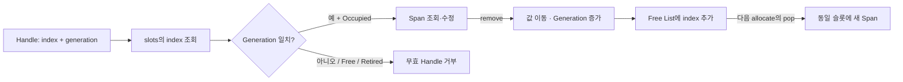
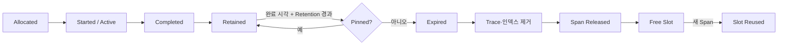
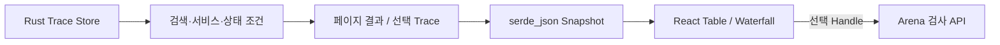

# TraceScope 구조와 수명 관리

TraceScope의 데이터 원본(Source of Truth)은 브라우저 안에서 실행되는 하나의 Rust `Engine`이다. Rust는 시나리오, 가상 시계, 예약 이벤트, Trace, Span, 검색 인덱스, 보존 정책과 진단 이력을 소유한다. React는 탭·검색 조건·선택 ID와 화면에 필요한 제한된 조회 결과만 보관한다.

## 전체 구조

| 위치 | 책임 |
| --- | --- |
| `engine/src/lib.rs` | wasm-bindgen 공개 API와 JSON 조회 경계 |
| `engine/src/model.rs` | Trace·Span·Handle 기반 관계와 UI용 view |
| `engine/src/arena.rs` | 슬롯 소유권, Free List, Generation 검사와 Retired 처리 |
| `engine/src/store.rs` | Trace·Span 변경, 조회, 인덱스, Pin과 Retention |
| `engine/src/scenario.rs` | 고정 Seed 난수와 다섯 시나리오의 요청 계획 |
| `engine/src/simulation.rs` | 가상 시계, 이벤트·만료 처리 순서, Tick 예산과 메트릭 |
| `engine/src/diagnostics.rs` | Lifecycle Ring Buffer와 진단 snapshot 타입 |
| `web/src/engine.ts` | 단일 WASM 인스턴스, 프레임 Tick, 250ms UI 갱신, 실제 메모리 바이트 조회 |
| `web/src/App.tsx` | Live Overview·Trace Explorer·Developer Tools와 선택 상태 |

제품은 외부 요청을 수집하지 않는다. 모든 요청은 Rust 내부에서 생성하는 합성 데이터이며 화면에 **Simulated Live**로 표시한다. 서버·DB·WebSocket 연결은 없다.

## 가상 시간과 결정론

시나리오는 요청 도착 시 Xorshift 난수 생성기로 처리 기간과 결과를 정한다. 난수는 렌더 프레임에서 호출하지 않는다. 각 예약 이벤트는 가상 시각과 단조 증가하는 순번으로 정렬하므로 같은 시각의 이벤트도 처리 순서가 일정하다. 메트릭 집계는 가상 시간 이벤트로 수행한다. Retention은 완료 시각과 ID로 정렬한 별도 인덱스의 다음 만료 시각을 이벤트 큐의 다음 시각과 비교해 처리한다. 두 시각이 같으면 해제를 먼저 수행한다.

`tick(real_delta_ms)`는 재생 중일 때 실제 경과 시간에 0.25·1·4 배율을 곱해 목표 가상 시각을 이동시킨다. 한 번의 호출은 예약 이벤트와 만료 처리를 합쳐 최대 5,000건을 처리한다. 상한에 도달하면 남은 작업을 보존하고 다음 Tick에서 이어 처리한다. `target_ms`는 요청한 시각, `now_ms`는 처리한 시각이다. Diagnostics의 due events와 backlog는 아직 처리하지 못한 작업을 드러낸다.

`step(virtual_delta_ms)`는 일시정지 상태에서 지정한 가상 시간만 진행하며 속도 배율을 적용하지 않는다. 큰 Tick과 여러 작은 Tick은 같은 목표 시각까지 대기 이벤트를 모두 처리한 후 비교한다. 중간에 예산을 소진한 시점의 snapshot은 아직 같은 가상 시각의 상태가 아니다.

브라우저 프레임의 소수점 밀리초는 Kahan 합산으로 누적한다. 원래 누적값을 유지하면서 공개 목표 시각만 1ns(`0.000001ms`) 단위로 정규화하고, 이벤트는 정수 밀리초 경계에서 처리한다. 개별 프레임을 반올림하지 않으므로 작은 시간 조각을 계속 전달해도 누적 잔여가 사라지지 않는다. 60fps 간격과 0.25×에서도 정수 밀리초 경계의 처리 결과를 비교한다.

페이지가 숨겨지면 UI가 엔진을 일시정지하고 이전 프레임 시각을 비운다. 페이지로 돌아온 뒤에는 Play를 눌러 재개한다. 숨겨진 동안의 시간을 한꺼번에 누적하지 않는다. 시나리오 변경은 데이터와 진단 이력을 초기화하고 일시정지 상태로 돌아온다.

## Trace와 Span

한 Trace는 `gateway → auth / orders → database / cache` 관계의 Span 다섯 개를 가질 수 있다. Span은 자신의 수치 ID, Trace ID, 서비스 ID, 부모 Handle, 시작·종료 시각과 상태를 가진다. Trace는 Span의 Handle 목록과 요청 상태·Pin 여부를 소유한다. 서비스·Operation은 고정 배열의 작은 ID로 저장하며 Attributes는 상세 조회 시 제한된 키로 만든다.

Span 시작 이벤트에서 실제 `Span` 값을 Arena에 할당한다. 종료 이벤트는 같은 Handle을 통해 값을 찾아 종료 시각과 결과를 갱신한다. 요청의 최종 종료 시각은 최대 8초이며 Error Storm의 Timeout도 이 경계에서 종료된다. 자식 Span은 부모보다 먼저 또는 같은 시각에 끝난다. 진행 중 Trace는 Retention 대상에서 제외한다.

Waterfall의 왼쪽 위치는 `span.start_ms - trace.start_ms`, 길이는 `span.end_ms.unwrap_or(now_ms) - span.start_ms`에서 계산한다. 부모 관계 역시 저장된 Handle을 사용한다. 완료 전 막대는 엔진이 처리한 현재 가상 시각까지 표시한다.

## Handle과 Generational Arena

`Handle { index: u32, generation: u32 }`은 슬롯 위치와 해당 슬롯의 세대를 함께 나타낸다. Index만 보관하면 해제한 슬롯에 다른 Span이 들어온 뒤 오래된 선택이 새 Span을 가리킬 수 있다. Generation을 함께 검사하면 이전 선택을 무효 상태로 판정할 수 있다.

`Arena<T>`는 `Vec<Slot<T>>`와 `Vec<u32>` Free List를 소유한다. 새 슬롯은 Generation 1로 시작한다. 제거할 때 `Option<T>::take()`로 값을 꺼내고 Generation을 증가시킨 뒤 Index를 Free List에 넣는다. 호출자가 반환된 값을 버리면 Rust의 Drop이 실행된다. 다음 할당은 Free List의 마지막 Index를 먼저 사용한다. 빈 슬롯이 없을 때만 슬롯 벡터를 늘린다.

Generation이 `u32::MAX`인 슬롯을 제거하면 슬롯을 **Retired**로 만들고 Free List에 넣지 않는다. 따라서 Generation을 0으로 되돌려 오래된 Handle이 다시 유효해지는 경로가 없다. 잘못된 Index, 다른 Generation, 이미 해제한 값은 조회·수정·제거를 거부한다. 이중 제거는 Free List 항목을 중복으로 만들지 않는다.

Arena의 역할은 Span의 위치와 수명을 관리하는 것이다. `Vec`, 인덱스, JSON 직렬화 등의 할당은 Rust 기본 Allocator와 Ownership/RAII를 따른다. Custom GC와 별도 범용 Allocator는 사용하지 않는다.

## Retention과 명시적 해제

기본 Retention은 완료 시점부터 가상 시간 60초이며 설정 범위는 5~120초다. 만료한 Trace를 제거할 때 소속 Span을 모두 회수하고 Trace 조회·서비스 검색 인덱스도 함께 정리한다. Pin은 최대 128개이며, 완료 후에도 보존 정책의 예외로 남는다. 만료한 Trace를 Unpin하면 다시 정리 대상이 된다.

Retention 설정 변경은 현재 `now_ms`를 기준으로 만료한 Trace만 최대 5,000건 정리한다. 일시정지 중 쌓여 있는 시간 대기량을 소비하거나 새로운 요청 이벤트를 처리하지 않는다. 남은 정리는 다음 Tick 또는 Step에서 이어 수행한다.

Pinned Traces 시나리오는 초기 요청 중 5·15·25번을 자동으로 Pin한다. 이후 수동 Unpin은 그대로 유지한다. 정상 시나리오에서는 Pin된 Trace가 없을 때 생성 속도와 보존 기간에 비례한 수의 Span이 남고, 만료로 생긴 Free Slot을 새 요청이 재사용한다. Burst가 끝난 뒤에도 확보한 슬롯 수를 유지할 수 있다.

## 조회 경계와 진단 비용

공개 인터페이스는 [API 계약](api-contract.md)에 정리했다. UI는 Span마다 WASM을 호출하지 않고 페이지 단위로 조회한다. 목록은 API 최대 50개, UI 기본 25개이며 상세는 선택한 Trace 하나만 요청한다. 상위 탭을 바꿔도 `web/src/engine.ts`의 단일 인스턴스를 계속 사용한다.

| 데이터 | 상한·갱신 방식 |
| --- | --- |
| Lifecycle Ring Buffer | 2,048개. 오래된 이벤트를 버리고 누적 dropped 수를 제공 |
| Lifecycle 조회 | 호출당 최대 200개, Cursor 지원 |
| Rust 시계열 | 120개, 가상 1초 경계에서 표본 생성 |
| 집계용 요청 도착·완료 기록 | 최근 가상 10초, 각각 최대 50,000개 |
| JS Linear Memory 시계열 | 최대 120개, snapshot 시 가상 시간 1초 이상 차이가 날 때 추가 |
| Arena 조회 | 호출당 최대 512슬롯 |
| Trace 목록 | 호출당 최대 50개 |
| Pin | 최대 128 Trace |
| UI snapshot | 기본 250ms 간격, 엔진 Tick은 animation frame에서 별도 진행 |

Lifecycle 상세 기록을 끄면 이벤트 문자열과 기록을 추가하지 않는다. 객체·슬롯·이벤트 큐의 기본 계측은 계속 유지된다. 정상 이벤트 큐를 버리는 것과 진단 Ring Buffer의 오래된 기록을 교체하는 것은 서로 다른 동작이다. 전자는 대기 상태로 보존하고 후자는 명시한 상한으로 교체한다.

안전한 Stale Handle 검사는 같은 Arena에 임시 Span을 할당하고 제거·재할당한 다음 이전 Handle로 조회한다. 실제 Trace의 Span을 제거하거나 바꾸지 않는다. 임시 할당과 회수도 Arena 누적 카운터 및 Lifecycle에 반영되므로 수치에 포함된다.

## 메모리 수치 읽기

| 메트릭 | 단위 | 의미 |
| --- | --- | --- |
| Active Span Count / Live Spans | 객체 수 | 진행 중·완료 후 보존 중인 Span을 포함한 현재 할당 값 |
| Active Trace Count | Trace 수 | 저장소에 남아 있는 진행 중·보존 중 Trace |
| Active Requests | 요청 수 | 아직 완료하지 않은 요청 |
| Retained Trace Count | Trace 수 | 완료 후 저장소에 남은 Trace |
| Occupied Slots | 슬롯 수 | 현재 Span 값이 있는 슬롯 |
| Free Slots | 슬롯 수 | 다음 할당에서 재사용 가능한 슬롯 |
| Retired Slots | 슬롯 수 | Generation 초과로 재사용을 중단한 슬롯 |
| Arena Capacity | 슬롯 수 | `slots.len()`, 생성한 논리 슬롯 총수 |
| Arena Reserved Slots | 슬롯 수 | `slots.capacity()`, 벡터가 재할당 없이 담을 수 있는 예약 공간 |
| Reused Slot Count / Reuse Ratio | 횟수 / % | Free List에서 꺼내 할당한 횟수 / 전체 누적 할당 |
| WASM Linear Memory | bytes / MiB | 실제 `WebAssembly.Memory.buffer.byteLength` |

RPS는 최근 가상 10초의 요청 도착 수로 계산하며 초기 10초에는 경과 시간을 분모로 사용한다. P50·P95·P99와 Error Rate는 같은 기간에 완료한 요청으로 계산한다. 서비스별 Active Spans는 진행 중 Span 수, Completed Spans와 Errors는 Reset 이후 누적 수다.

Arena Capacity는 `Vec::capacity()`가 예약한 미초기화 여유 공간과 구별한다. 또한 Linear Memory에는 Arena 이외의 Rust 할당, 직렬화 버퍼, 스택 등의 영역도 들어간다. 따라서 Live Span이 줄어드는 순간에도 Linear Memory 바이트는 그대로 남을 수 있다. 이미 확보한 메모리를 다음 할당에 재사용하는 흐름은 정상적인 관찰 결과다.

JS는 `WebAssembly.Memory` 객체를 보관하되 `.buffer`는 매번 다시 읽는다. 메모리가 확장되면 이전 `ArrayBuffer`가 분리될 수 있으므로 오래된 TypedArray view를 Span 조회에 사용하지 않는다. JSON snapshot은 호출 시 복사된 값이다. 표준 동작은 [WebAssembly.Memory.grow 문서](https://developer.mozilla.org/en-US/docs/WebAssembly/Reference/JavaScript_interface/Memory/grow)를 참고한다.

## 안정성 검증 기준

정상 부하에서는 충분한 가상 실행 후 Live Span과 인덱스 수가 일정 범위에 머무는지, 논리 슬롯 수가 안정되는지, 누적 재사용이 계속 증가하는지 함께 확인한다. Burst에서는 슬롯 증가 이후 Retention을 지나 객체가 회수되고 남은 슬롯을 재사용하는지 확인한다. Pin은 보존되는 Trace와 Unpin 후 실제 회수를 따로 확인한다.

WASM Linear Memory만으로 Rust 전체 힙의 live allocation 바이트를 계산할 수 없다. 이 제품은 일반 Allocator의 개별 할당 바이트를 계측하지 않는다. 장시간 검증의 실제 조건·수치·브라우저 범위는 [검증 기록](validation.md)에 남긴다.
