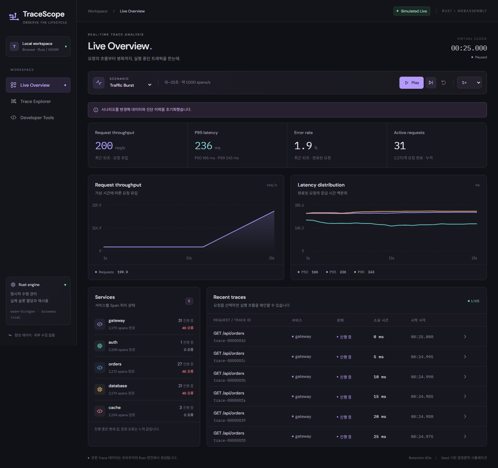
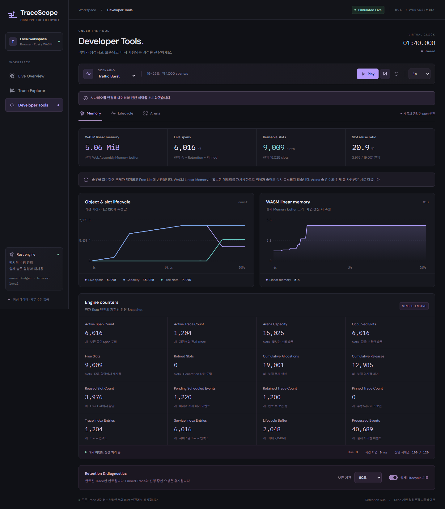

# 검증 기록

확인일: 2026-10-12(KST). 모든 데이터는 Seed 42의 합성 요청이다. 엔진·UI·측정 코드는 이 저장소에 있으며 기존 `tracescope` 프로젝트는 수정하지 않았다.

## 실행 환경

- Windows 10 10.0.19045 x64, AMD Ryzen 7 3700X, Node.js 25.9.0.
- Rust 1.99.0, 네이티브 host `x86_64-pc-windows-gnu`, WASM target `wasm32-unknown-unknown`.
- Playwright 1.64.0, Chromium 156.0.8078.4, 1440×1000 및 390×844.
- 로컬 프로덕션 URL: `http://127.0.0.1:4179/tracescope-wasm/`.
- MSVC linker가 없는 로컬 환경에서 기존 GNU toolchain과 PATH의 MinGW GCC를 사용했다. 전역 Rust 기본값은 변경하지 않았다.
- Rust release LTO를 사용한다. 선택적 `wasm-opt` 실행은 로컬 도구의 접근 오류 후 `wasm-opt = false`로 비활성화했다.

## 기능 검증

| 검사 | 실제 결과 | 근거 |
| --- | --- | --- |
| Rust Arena | 9개 통과 | [arena.rs](../engine/src/arena.rs)의 최초 할당, 수정, Drop, 해제, Free List, 재사용, stale·잘못된 handle, 이중 해제, 오버플로 퇴역 |
| Rust 엔진 | 34개 통과 | [engine.rs](../engine/tests/engine.rs)의 lifecycle, Pin128개 상한, 인덱스 정합성, 최대8초 Timeout, 결정론, retention 변경, 장시간 부하 |
| Rust 형식·정적 분석 | 통과 | `cargo fmt --check`, `cargo clippy --all-targets -- -D warnings` |
| 실제 WASM | 6개 통과 | [wasm-runtime.test.mjs](../tests/wasm-runtime.test.mjs), Node의 실제 WebAssembly 런타임 |
| TypeScript·Vite | 통과 | `npm run build`의 WASM 생성, `tsc --noEmit`, 프로덕션 정적 asset 생성 |
| Chromium 제품 흐름 | 9개 통과 | [product.spec.ts](../tests/product.spec.ts). 로컬8개+추가1개, CI9개 일괄, 실제 공개 Pages9개 일괄 통과 |
| npm 의존성 | 알려진 취약점0건 | 현재 lockfile에 대한 `npm audit` 및 `npm audit --omit=dev` |

Rust 테스트는 실제 수 분을 기다리지 않고 가상 시간으로 진행한다. 600초 정상 부하 검사는 매초 Trace 소속·부모 Handle·서비스 인덱스·만료 인덱스·슬롯 분할 정합성을 함께 확인한다. WASM 테스트도 600초 가상 실행 후 실제 인덱스 수와 live 슬롯 수, Ring Buffer 상한을 확인한다.

브라우저 테스트는 프로덕션 빌드의 `/tracescope-wasm/` 하위 경로에서 실행한다. WASM 초기화, 실시간 갱신, Pause·Step·Reset·속도, 검색·필터·정렬·페이지 이동, 실제 Waterfall 위치, Pin/Unpin, 동일 Span의 Arena 추적, 만료 후 Handle 무효화, Memory·Lifecycle·Canvas, 상세 기록 토글, 다섯 시나리오 선택, 페이지 숨김 정책, 모바일 폭, WASM 실패 화면을 확인했다. 페이지 숨김 검사는 `visibilitychange`와 `document.hidden` 조건을 재현하는 자동화 검사다.

## 결정론과 수명 경계에서 수정한 결함

- `100 × 0.1ms` 및 `60 × (1000/60)ms`의 단순 부동소수점 누적이 10ms·1000ms 직전으로 남아 경계 이벤트가 한 Tick 늦어지는 문제를 수정했다. 입력별 반올림을 하지 않고 Kahan 합산의 원본 누적값을 유지한 뒤 목표 시각을 1ns 단위로 투영한다. 0.25×·4800프레임·아주 작은 잔여 시간도 테스트한다. 이벤트 타임스탬프는 정수 ms다.
- 정확히 Tick 예산을 소진했지만 남은 due 이벤트가 없는 경우 현재 시각을 목표 시각으로 맞춘다.
- 일시정지 중 Retention 설정 변경은 현재 시각의 만료만 정리한다. 새 요청을 생성하거나 누적된 시계 진행을 소비하지 않는다.
- 초기 WASM 로드 실패는 오류 화면과 다시 불러오기 버튼으로 표시한다.
- 모바일 테이블의 숨김 라벨이 페이지 폭을 늘리던 배치와 토글의 클릭 가림을 수정했다.
- 해제된 Handle을 선택한 상태에서 슬롯이 재사용되어도 이전 Span의 유효성은 false로 유지한다. 현재 슬롯 Generation은 별도로 조회한다.

## 정상 부하와 Burst의 실제 WASM 메모리

[원본 결과](results/wasm-benchmark.json), [실행 코드](../scripts/benchmark-wasm.mjs). 각 시나리오는 독립 Node 프로세스에서 release WASM을 실행했다. Retention60초, 상세 진단 켜짐, 100ms 가상 Step이다. 호출 경과 시간은 WASM 호출과 JS 경계를 포함하며 실제 브라우저 프레임 측정과 구분한다.

| 조건 | Normal | Traffic Burst |
| --- | ---: | ---: |
| 가상 실행 시간 | 600초 | 180초 |
| Span 유입 | 100/s | 100/s, 15~25초만1,000/s |
| 총 처리 이벤트 | 131,395 | 58,371 |
| 최종 live Span | 6,006 | 6,011 |
| Arena 논리 슬롯 | 6,025 | 15,025 |
| Vec 예약 슬롯 | 8,192 | 16,384 |
| 최종 Free Slots | 19 | 9,014 |
| 누적 할당 / 해제 | 60,001 / 53,995 | 27,001 / 20,990 |
| 재사용 횟수 | 53,976 | 11,976 |
| 최종 Linear Memory | 3,407,872bytes (3.25MiB) | 5,308,416bytes (5.0625MiB) |
| Tick P95 | 0.0283ms | 0.1423ms |
| Trace Query P95 | 0.2936ms | 0.5650ms |

Normal의 가상90~600초 표본에서 live Span은 6,006~6,021개, Arena6,025슬롯, Linear Memory3.25MiB로 유지됐다. 마지막 상태의 Trace 인덱스1,202개는 live Trace1,202개와 같고, 서비스 인덱스6,006개는 live Span6,006개와 같다. 만료 인덱스1,199개는 완료 후 보존 중인 Trace1,199개와 일치했다.

Burst는 90초 시점에 live Span6,016개·Free9,009개로 돌아왔다. 이후에도 확보한15,025슬롯을 사용했고, 180초에는 재사용11,976회가 기록됐다. 높은 Linear Memory 값은 회수된 공간을 재사용하는 상태와 함께 관찰됐다. 이 측정에서 정상 부하의 지속적인 슬롯·Linear Memory 증가 추세는 나타나지 않았다. 일반 Allocator의 개별 live heap 바이트나 브라우저 전체 프로세스 메모리는 측정하지 않았다.

Lifecycle은 두 실행 모두 최대2,048개, 엔진 시계열은120개였다. 완료 지연·Pin 보존·Free Slot·예약 공간·Linear Memory를 각각 구분해 검사했다.



가상25초 Overview. 15~25초의 실제 합성 요청 증가와 지연 백분위를 표시한다.



가상100초 Memory. live Span 감소, Free Slots 증가와 유지된 Arena Capacity를 함께 볼 수 있다.

## 네이티브 스트레스 검사

[원본 결과](results/native-benchmark.json), [벤치마크](../engine/examples/benchmark.rs). Rust release·GNU host에서 각120초 가상 실행, 100ms Step, Seed42, Retention60초, 상세진단ON. 조회는 database 필터·duration 내림차순·25건,20페이지다. WASM 측정의 기본 최신순 조회와 조건이 다르므로 두 표의 시간을 직접 비교하지 않는다.

| 부하 | Tick P95 | Query P95 | 90~120초 Arena 슬롯 | 최종 재사용 |
| --- | ---: | ---: | ---: | ---: |
| 100 spans/s | 0.0296ms | 0.5822ms | 6,025 고정 | 5,976 |
| 1,000 spans/s | 0.2706ms | 7.4202ms | 60,198 고정 | 59,794 |
| 10,000 spans/s | 2.8824ms | 73.3550ms | 601,660 고정 | 598,230 |

세 부하 모두 최종 정합성 검사가 통과했다. Arena 정수 값 할당·해제100,000쌍의 마이크로벤치마크는 평균5.024ns/쌍, 재사용99,999회였다. 실제 Span 처리 비용은 이벤트·인덱스·진단 기록까지 포함하는 위 Tick 측정에 나타난다. 10,000 spans/s의 전체 후보 정렬 조회는 비용이 크며, 이 부하는 네이티브 스트레스 조건이다. 제품 UI에는 이 부하 선택 기능을 노출하지 않는다.

## 브라우저 응답성

[원본 결과](results/browser-benchmark.json), [실행 코드](../scripts/benchmark-browser.mjs). Headless Chromium의 Live Overview에서 정상100 spans/s와 Burst1,000 spans/s 구간을 각각 실제10초 동안1×로 실행했다. 두 구간 모두 프레임 간격 P95 약16.7ms, P99 약16.8ms, 관찰된50ms 초과 Long Task0개였다. 최대 간격은 정상33.3ms, Burst16.8ms였다. CPU/GPU throttling을 적용하지 않았으며 브라우저 스케줄링과 호스트 부하가 포함된 관찰값이다. 모바일 실기기·Safari·Firefox 성능은 미검증이다.

## 재현 명령

```sh
cargo test --manifest-path engine/Cargo.toml --locked
cargo fmt --manifest-path engine/Cargo.toml --check
cargo clippy --manifest-path engine/Cargo.toml --all-targets -- -D warnings
npm ci
npm run build
npm run test:wasm
npx playwright install chromium
npm run test:e2e
npm run bench:wasm
cargo run --release --manifest-path engine/Cargo.toml --example benchmark
```

브라우저 실측은 별도 터미널에서 `npm run preview`를 실행한 뒤 `npm run bench:browser`로 수행한다. 화면 저장은 `CAPTURE_SCREENSHOTS=1` 환경 변수와 `npm run test:e2e`를 사용한다. Windows GNU 설정은 [README](../README.md)의 로컬 실행 안내를 따른다.

## 배포 검증

공개 저장소 [okorion/tracescope-wasm](https://github.com/okorion/tracescope-wasm)과 HTTPS 배포 사이트 [TraceScope](https://okorion.github.io/tracescope-wasm/)를 확인했다. 기존 `tracescope` 저장소가 있어 새 이름을 사용했다.

- 제품 코드 커밋: `30a5579c09007b329fc1cadf07e00b138f1df9c3`.
- [첫 GitHub Actions 실행](https://github.com/okorion/tracescope-wasm/actions/runs/38203317957): Rust fmt·clippy·43개 테스트, WASM·TypeScript 빌드, WASM6개 테스트, Chromium9개 E2E, Pages 배포 모두 성공. Linux runner, Node24, Rust1.99.0을 사용했다.
- 실제 공개 URL을 `PLAYWRIGHT_BASE_URL`로 지정한 재검사: **9개 통과, 25.8초**. 시뮬레이션·검색·Waterfall·Pin·세 Developer Tools·슬롯 회수·다섯 시나리오·모바일 폭·실패 화면을 검사했다.
- 2026-10-12 13:23(KST) 추가 확인: 페이지 HTTP200, 해시가 붙은 WASM asset HTTP200·`application/wasm`, 가상5초 요청 생성과 Memory 화면 확인, `pageerror`0건. [조회 원본](results/deployment-check.json).

이후 문서 검증 기록만 갱신한 커밋도 같은 CI와 배포 절차를 따른다. 최신 배포 대상 커밋은 [Actions 실행 목록](https://github.com/okorion/tracescope-wasm/actions)을 통해 확인할 수 있다.

## 완료 기준과 범위

| 요구사항 묶음 | 확인 결과 |
| --- | --- |
| 정적 앱·외부 백엔드 없음·다섯 시나리오·실시간 요청·지연·오류·Waterfall·Pin | 완료 — 빌드, 엔진 및 브라우저 검사 |
| Rust 소유권·직접 Arena·Generation·Retention·실제 Free List 재사용·stale 거부·Custom GC 제외 | 완료 — Rust43/WASM6 테스트와 소스 검사 |
| 동일 엔진 진단·실제 Linear Memory·Live/Free·Lifecycle·Span→Arena·버퍼 상한 | 완료 — 단일 엔진 연결과 브라우저 검사 |
| 정상 장기 재사용·인덱스 정리·Burst 복귀·Pin 해제 | 완료 — 가상600초/180초, 원본 수치와 정합성 테스트 |
| 실제 화면·README·아키텍처 | 완료 — 실제 Chromium8종 캡처와 구현 기반 문서 |
| 공개 GitHub·원격 CI·실제 Pages 실행 | 완료 — 공개 저장소, CI 전체 성공, 배포 URL에서9개 E2E 통과 |

Pin은 사용자 보존 정책이며 최대128개다. 새로고침/Reset은 데이터를 지운다. 시나리오는 고정 서비스 구조이며 임의 로그 수집, OpenTelemetry 가져오기, 저장·내보내기와 다중 사용자는 현재 지원하지 않는다.
